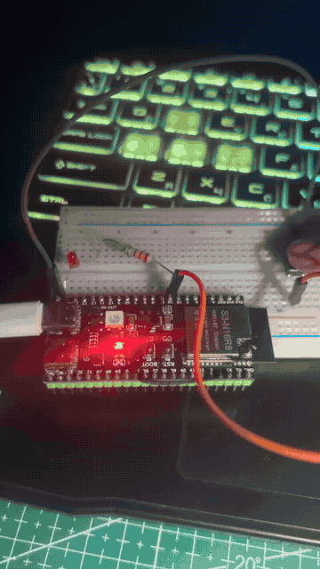

# Домашня робота 2.1 — Неблокуюче керування LED

Проєкт для ESP32-S3 на Arduino: світлодіод блимає без `delay()`, кнопка перемикає режими, а Serial Monitor показує середній час виконання логіки циклу.

## Демонстрація



## Як це працює

- Після запуску LED увімкнений і змінює стан кожні **1000 мс**: секунду світиться, секунду вимкнений.
- Кожне натискання кнопки перемикає режим: **блимання → постійно увімкнено → постійно вимкнено → блимання**.
- Час відстежується через `millis()`: цикл `loop()` продовжує обробляти кнопку між перемиканнями LED.
- Переривання кнопки лише встановлює `volatile`-прапорець. Обробка подій і антидребезг **40 мс** виконуються в `loop()`.
- Через кожні **1000 ітерацій** у Serial Monitor виводиться середній час логіки циклу в мікросекундах, виміряний через `micros()`. Друк звіту у вимірювання не входить.

Клас `Led` інкапсулює керування виходом і стани `enum class`. Налаштування зібрані у `Config` як `static constexpr`, а об’єкт LED створюється як локальний `static` у `getLed()`.

## Підключення

| Компонент | Підключення |
| --- | --- |
| LED | GPIO **15** → струмообмежувальний резистор → анод LED; катод → GND |
| Кнопка | Між GPIO **16** та GND; використовується внутрішня підтяжка `INPUT_PULLUP` |

## Запуск

У PlatformIO налаштовано плату `adafruit_feather_esp32s3_nopsram`, платформу `espressif32` та фреймворк Arduino. Підключіть плату через USB і виконайте в папці проєкту:

```sh
pio run
pio run --target upload
pio device monitor --baud 9600
```

Основна логіка — у `src/main.cpp`, клас світлодіода — у `include/Led.h` та `src/Led.cpp`.
