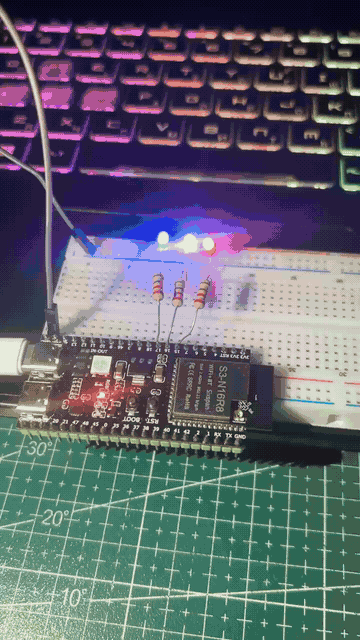

# Домашня робота 2.3 — Superloop

Проєкт для ESP32-S3 на Arduino: три світлодіоди незалежно блимають із різними інтервалами в одному `loop()` без блокування.

## Демонстрація



## Як це працює

Після запуску всі LED вимкнені. Кожен змінює стан за власним інтервалом:

| Світлодіод | GPIO | Інтервал перемикання | Повний цикл блимання |
| --- | --- | --- | --- |
| LED1 | 15 | 200 мс | 400 мс |
| LED2 | 16 | 500 мс | 1000 мс |
| LED3 | 17 | 1000 мс | 2000 мс |

Структура `Led` зберігає пін, інтервал, час попереднього перемикання та поточний стан кожного світлодіода. На кожній ітерації `loop()` програма отримує час через `millis()` і перевіряє всі LED. Якщо інтервал минув, відповідний LED перемикається; інакше цикл одразу переходить до наступного.

## Відповідність ТЗ

- Три незалежні процеси виконуються в одному superloop з інтервалами **200, 500 і 1000 мс**.
- `delay()` та `while()` для очікування часу не використовуються.
- Час відстежується через `millis()`, тому очікування одного LED не затримує інші.

## Підключення

Для кожного LED: відповідний GPIO → окремий струмообмежувальний резистор → анод LED; катод → GND. Земля плати та макетної плати має бути спільною.

## Запуск

У PlatformIO налаштовано плату `adafruit_feather_esp32s3_nopsram`, платформу `espressif32` та фреймворк Arduino. Підключіть плату через USB і виконайте в папці проєкту:

```sh
pio run
pio run --target upload
```

Уся логіка — у `src/main.cpp`.
