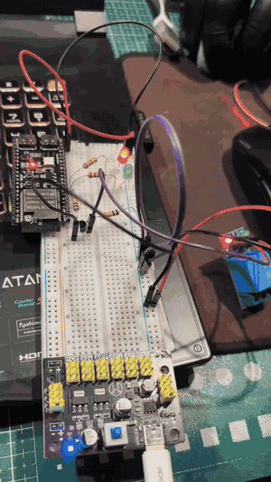

# Домашня робота 2.5 — Апаратні таймери

Керування витяжним вентилятором на ESP32-S3: вентилятор (реле) вмикається щогодини на 15 хвилин, після чого автоматично вимикається. Увесь цикл працює на апаратному таймері та його перериванні, без `delay()` і без коду в `loop()`.

## Демонстрація



У демонстрації використано тестові інтервали: період 20 с, робота 5 с.

## Як це працює

Використовується один апаратний таймер (`timer 0`, дільник 80 → 1 тік = 1 мкс) з `autoreload = true`. При кожному спрацюванні обробник переривання `onTimer()`:

1. перемикає реле та LED-індикатори;
2. запам'ятовує новий стан у `volatile bool isRelayActive`;
3. задає через `timerAlarmWrite()` час до наступного спрацювання.

Інтервали чергуються так, що вентилятор вмикається рівно кожні `RELAY_INTERVAL`:

```
 ON ──(WORK_INTERVAL)──► OFF ──(RELAY_INTERVAL − WORK_INTERVAL)──► ON ...
```

Після старту вентилятор вимкнений, і перше ввімкнення відбувається через `RELAY_INTERVAL`.

| Параметр | Тестове значення | Робоче значення |
| --- | --- | --- |
| `RELAY_INTERVAL` — період вмикання | 20 000 мс | 3 600 000 мс (1 год) |
| `WORK_INTERVAL` — час роботи | 5 000 мс | 900 000 мс (15 хв) |

Константи мають тип `uint64_t`, тому переведення в мікросекунди (`* 1000`) не переповнюється. `static_assert` не дає скомпілювати проєкт, якщо час роботи не менший за період.

## Відповідність ТЗ

- [x] Вентилятор керується через реле (GPIO15).
- [x] Таймер працює незалежно від коду в циклі: уся логіка — в ISR.
- [x] `delay()` не використовується.
- [x] Цикл повторюється без участі `loop()`: функція порожня.
- [x] Час роботи і період задаються константами `constexpr`.
- [x] Для налагодження 1 год замінено на 20 с, 15 хв — на 5 с.

Опційно:

- [x] LED-індикатори, що дублюють поточний стан: зелений — вентилятор працює, червоний — очікування.
- [ ] Watchdog
- [ ] Логування станів
- [ ] Захист від повторного запуску

## Підключення

| Сигнал | GPIO |
| --- | --- |
| Реле вентилятора | 15 |
| Зелений LED (працює) | 16 |
| Червоний LED (очікування) | 17 |

Кожен LED підключено через струмообмежувальний резистор до GND. Земля плати та макетної плати спільна.

## Запуск

Плата `adafruit_feather_esp32s3_nopsram`, платформа `espressif32`, фреймворк Arduino (API таймерів core 2.x). Для робочого режиму замініть у `src/main.cpp` тестові значення констант на 3 600 000 і 900 000.

```sh
pio run
pio run --target upload
```
