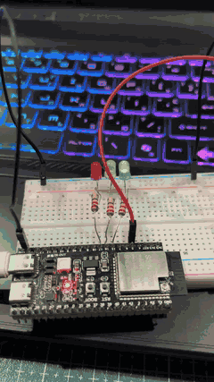

# Домашня робота 2: світлофор за ПДР України

Світлофор на ESP32-S3 і ESP-IDF, що перемикає сигнали в порядку, встановленому ПДР України. Кнопка вмикає режим жовтого миготливого сигналу (нерегульоване перехрестя) і вимикає його. Відлік часу веде апаратний таймер `gptimer`. Затримки на кшталт `vTaskDelay(10000)` не використовуються, тому програма відразу реагує на кнопку.

## Демонстрація



## Послідовність сигналів

| Стан | Світлодіоди | Тривалість | Наступний стан |
| --- | --- | --- | --- |
| `GREEN_LIGHT` | зелений | 10 с | `GREEN_BLINK` |
| `GREEN_BLINK` | зелений миготить, 1 Гц | 3 с (3 спалахи) | `YELLOW_LIGHT` |
| `YELLOW_LIGHT` | жовтий | 3 с | `RED_LIGHT` |
| `RED_LIGHT` | червоний | 10 с | `RED_YELLOW_LIGHT` |
| `RED_YELLOW_LIGHT` | червоний + жовтий | 2 с | `GREEN_LIGHT` |
| `YELLOW_BLINK` | жовтий миготить, 1 Гц | до натискання кнопки | `RED_LIGHT` |

Червоний разом із жовтим горить 2 с: це максимум, який дозволяє ДСТУ. Зелений і червоний тривають по 10 с, щоб демонстрація була короткою. На реальному перехресті ці фази тривають 20–60 с. Усі тривалості задано через `#define` на початку `src/main.c`.

Натискання кнопки в будь-якому стані звичайного циклу вмикає `YELLOW_BLINK`. Наступне натискання повертає світлофор до `RED_LIGHT`, бо після нерегульованого режиму найбезпечніше почати з червоного.

## Як це працює

### Скінченний автомат

Головний цикл раз на тік FreeRTOS (`vTaskDelay(1)`, 10 мс) зчитує поточний час і виконує `switch (currentState)`. Кожен стан влаштований однаково:

1. **Вхід у стан.** Один раз, коли прапорець `isStateEntered` ще дорівнює `false`, функція `set_lights(red, yellow, green)` вмикає потрібні світлодіоди.
2. **Перевірка часу.** Коли `currentTimeMs - lastToggledTimeMs` перевищує тривалість стану, `change_state(next, now)` запам'ятовує час переходу, встановлює новий стан і скидає `isStateEntered`.

Цикл не блокується: стан змінюється тоді, коли настав час, а між перевірками процесор вільний.

Миготіння не потребує окремого лічильника. Рівень світлодіода обчислюється з часу, що минув від входу в стан:

```c
level = ((now - lastToggledTimeMs) / BLINK_PERIOD_MS) % 2;   // 0,1,0,1… кожні 500 мс
```

### Апаратний таймер: власний `millis()`

Таймер `gptimer` рахує з частотою 1 МГц (1 одиниця = 1 мкс) і спрацьовує на значенні 1000 з автоперезапуском, тобто кожну 1 мс. Колбек переривання лише збільшує `volatile uint32_t millis`. Усі відліки часу в програмі, зокрема в автоматі й антибрязкоті, беруть час із цієї змінної.

```
gptimer_new_timer → register_event_callbacks → set_alarm_action → enable → start
```

Колбеки треба зареєструвати до `gptimer_enable`, інакше драйвер поверне помилку.

Лічильник `uint32_t` переповнюється через ~49,7 доби. Інтервали все одно рахуються правильно, бо беззнакове віднімання `now - last` працює за модулем 2³². Для цього всі змінні часу мають тип `uint32_t`: якщо змішати їх із `int64_t`, після переповнення різниця стане від'ємною і автомат зупиниться.

### Кнопка: переривання та антибрязкіт

Кнопка замикає GPIO5 на GND, увімкнено внутрішню підтяжку вгору (відпущена = 1, натиснута = 0). Переривання спрацьовує на обидва фронти (`GPIO_INTR_ANYEDGE`). Обробник переривання (ISR) зчитує рівень піна і приймає подію лише за двох умов одночасно:

- **рівень змінився** порівняно з останнім прийнятим (`lastButtonLevel`);
- **з останньої прийнятої зміни минуло понад 50 мс.**

Прийнята подія оновлює `lastButtonLevel` і час. Прапорець `isButtonPressed` ставиться лише на перехід 1 → 0. Відпускання теж приймається: воно оновлює запам'ятований рівень, але прапорця не ставить.

Брязкіт під час натискання (0 мс — прийнято, далі 1–4 мс) відсікається за часом. Брязкіт під час відпускання, навіть якщо кнопку тримали довго, теж потрапляє у 50-мілісекундне вікно після прийнятого переходу в 1. Тому одне натискання завжди дає рівно одне перемикання режиму.

ISR лише ставить прапорець. Стан світлофора змінює тільки головний цикл: він перевіряє `isButtonPressed` перед `switch`. Так зміна стану не перетинається з перериванням і завжди виконується повністю: час, стан і прапорець входу змінюються разом.

| Змінна | Хто пише | Хто читає | `volatile` |
| --- | --- | --- | --- |
| `millis` | ISR таймера | головний цикл, ISR кнопки | так |
| `isButtonPressed` | ISR кнопки, головний цикл (скидання) | головний цикл | так |
| `lastButtonLevel`, `lastButtonTimeMs` | ISR кнопки | ISR кнопки | ні |

## Підключення

| Сигнал | GPIO |
| --- | --- |
| Зелений LED | 15 |
| Жовтий LED | 16 |
| Червоний LED | 17 |
| Кнопка (на GND) | 5 |

Кожен LED підключено до GND через струмообмежувальний резистор.

## Запуск

Плата `adafruit_feather_esp32s3_nopsram`, платформа `espressif32`, фреймворк ESP-IDF.

```sh
pio run
pio run --target upload
```
