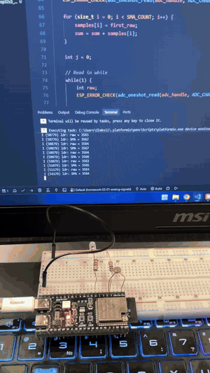

# Домашня робота 3.1: аналогові сигнали

Нічник на ESP32-S3 і ESP-IDF: фоторезистор (LDR) у подільнику напруги підключений до ADC1. Коли темнішає, світлодіод вмикається, а коли світлішає — вимикається. Значення АЦП читаються в режимі oneshot, згладжуються ковзним середнім (SMA), а мерехтіння біля межі усуває гістерезис із двох порогів.

## Демонстрація



## Завдання

1. Під'єднати LDR до ESP32 у вигляді подільника напруги, а його вихід — до одного з каналів ADC1.
2. Під'єднати світлодіод до будь-якого доступного GPIO.
3. Реалізувати зчитування значень з ADC у режимі oneshot.
4. Реалізувати Simple Moving Average (SMA) для фільтрації значень освітленості.
5. Використовуючи відфільтровані дані: коли стає темно — світлодіод вмикається, коли стає світло — вимикається.
6. Світлодіод не повинен мерехтіти при незначних коливаннях освітленості: реалізувати два пороги (гістерезис).

## Як це працює

### Подільник напруги

ESP32 не вміє міряти опір, тільки напругу. LDR разом із постійним резистором 10 кОм утворює подільник, і напруга в середній точці залежить від освітлення:

```
3V3 ── [LDR] ──┬── [10 кОм] ── GND
               │
             GPIO4 (ADC1_CH3)
```

- світло → опір LDR малий → напруга ближче до 3.3 В → велике число АЦП;
- темно → опір LDR великий → напруга ближче до 0 В → мале число АЦП.

Використано саме ADC1: ADC2 на ESP32 конфліктує з Wi-Fi.

### АЦП у режимі oneshot

Драйвер `esp_adc/adc_oneshot.h` налаштовується у два кроки, а потім значення читаються в циклі:

| Крок | Функція | Що робить |
| --- | --- | --- |
| 1 | `adc_oneshot_new_unit` | створює юніт `ADC_UNIT_1` і повертає його handle |
| 2 | `adc_oneshot_config_channel` | налаштовує `ADC_CHANNEL_3` (GPIO4) |
| 3 | `adc_oneshot_read` | одне вимірювання на запит, результат 0…4095 |

Параметри каналу:

- `ADC_ATTEN_DB_12` — атенюація, що розширює діапазон вимірювання приблизно до 3.1 В (без неї АЦП міряє лише до ~1 В);
- `ADC_BITWIDTH_DEFAULT` — 12 біт.

`adc_oneshot_read` повертає код помилки, а саме значення записує в змінну, адресу якої отримує (`&raw`). Тому `raw` має тип `int`, як того вимагає сигнатура функції.

### Ковзне середнє (SMA)

Сирі значення АЦП шумлять навіть при незмінному світлі. Фільтр зберігає останні `SMA_COUNT = 10` вимірювань у кільцевому буфері й усереднює їх.

Сума не перераховується циклом на кожній ітерації, а підтримується між ними: з неї віднімається значення, яке зараз буде затерте, і додається нове.

```c
sum = sum - samples[j];
samples[j] = raw;
sum = sum + samples[j];
```

Індекс `j` ходить по колу 0…9. Середнє дорівнює `sum / SMA_COUNT`.

Перед основним циклом АЦП читається один раз, і цим значенням заповнюється весь буфер, а `sum` набирає відповідну суму. Без цього перші 10 ітерацій буфер містив би нулі, середнє було б заниженим, і світлодіод на старті на мить вмикався б навіть на світлі.

### Гістерезис

Один поріг дає мерехтіння, коли освітлення коливається біля нього. Тому порогів два, а між ними «мертва зона»:

| Відфільтроване значення | Дія |
| --- | --- |
| `>= UPPER_RANGE` (2500) | світлодіод вимикається |
| `<= LOWER_RANGE` (1500) | світлодіод вмикається |
| між порогами | нічого не змінюється |

Для середньої зони окремий код не потрібен: якщо жодна умова не спрацювала, `gpio_set_level` не викликається, і пін зберігає попередній стан.

Пороги залежать від конкретного LDR, резистора та освітлення в кімнаті. Їх підбирають за значеннями `SMA` у лозі.

## Підключення

| Компонент | GPIO | Примітка |
| --- | --- | --- |
| Середня точка подільника LDR + 10 кОм | 4 | ADC1, канал 3 |
| LED | 15 | до GND через струмообмежувальний резистор |

## Лог

Кожні 100 мс у монітор порту виводяться сире і відфільтроване значення. Формат виводу (числа умовні):

```
I (1234) ldr: raw = 2061
I (1234) ldr: SMA = 2043
```

## Запуск

Плата `adafruit_feather_esp32s3_nopsram`, платформа `espressif32`, фреймворк ESP-IDF.

```sh
pio run
pio run --target upload
pio device monitor
```
