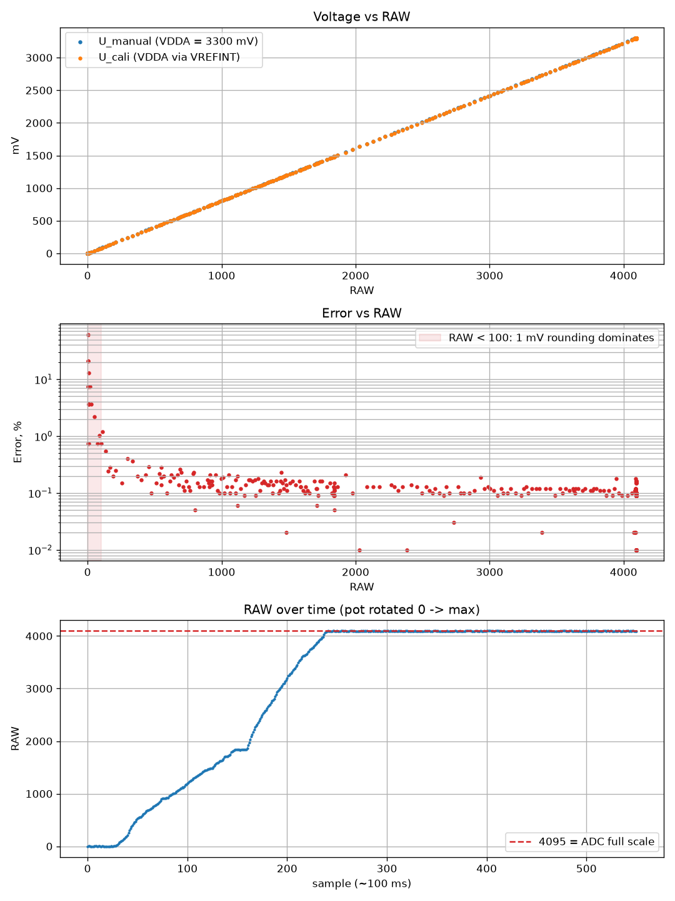

# Домашня робота 3.2: калібрування АЦП

STM32F411 (Blackpill) і STM32Cube HAL. Потенціометр 10 кОм у ролі подільника напруги підключений до ADC1. Кожні ~100 мс прошивка читає RAW, рахує напругу двома способами (за номінальною формулою і з калібруванням через VREFINT), обчислює похибку між ними і виводить таблицю в серійну консоль.

## Завдання

1. Підключити потенціометр (~10 кОм) у вигляді подільника напруги. Врахувати опорну напругу, атенюацію та розрядність.
2. Налаштувати АЦП та зчитувати значення кожні ~100 мс.
3. Для кожного вимірювання:
   - зчитати RAW і обчислити напругу за формулою;
   - зчитати напругу за допомогою каліброваного АЦП;
   - обчислити похибку (%) між обчисленою та каліброваною напругою.
4. Вивести таблицю в серійну консоль.

Опційно: побудувати графіки та знайти ділянки нелінійності.

## Параметри АЦП

| Параметр | Значення |
| --- | --- |
| Розрядність | 12 біт, RAW = 0…4095 |
| Опорна напруга | VDDA (на корпусі F411CE вивід VREF+ внутрішньо з'єднаний з VDDA), номінал 3300 мВ |
| Атенюація | немає: на STM32F411 її не існує, діапазон входу одразу 0…VDDA |
| Виміряна VDDA | 3295–3300 мВ |
| Режим | oneshot, програмний запуск, 480 циклів семплування |
| Тактування АЦП | HSI 16 МГц / 4 = 4 МГц |

## Як це працює

### Підключення

```
3V3 ──┐
      █  потенціометр 10 кОм
      ├──── PA1 (ADC1_IN1)
      █
GND ──┘
```

| Сигнал | Пін Blackpill | Примітка |
| --- | --- | --- |
| Повзунок потенціометра | PA1 | ADC1, канал 1. PA0 зайнятий кнопкою KEY |
| USART1 TX | PA9 | до RXD адаптера CH340G |
| USART1 RX | PA10 | до TXD адаптера CH340G |
| GND | G | спільна земля з адаптером |

Перемичка адаптера стоїть на 3V3, тож рівні сигналів 3.3 В. Плата живиться і прошивається через USB-C (DFU), а консоль іде через USB-UART адаптер.

### Напруга «за формулою»

АЦП повертає, яку частку від опорної напруги становить вхід. Формула припускає, що VDDA дорівнює номіналу:

```
U_manual = RAW × 3300 / 4095
```

### Калібрована напруга

На STM32 немає `adc_cali`, як в ESP-IDF. Його роль виконує внутрішнє джерело VREFINT (~1.21 В). На заводі його виміряли при точних VDDA = 3300 мВ і записали результат у пам'ять чипа (`VREFINT_CAL`, адреса `0x1FFF7A2A`). Прошивка щоразу міряє VREFINT, обчислює з нього реальну VDDA і вже з нею рахує напругу:

```
VDDA   = 3300 × VREFINT_CAL / VREFINT_RAW    // __LL_ADC_CALC_VREFANALOG_VOLTAGE
U_cali = RAW × VDDA / 4095                   // __LL_ADC_CALC_DATA_TO_VOLTAGE
Error  = |U_manual − U_cali| / U_cali × 100 %
```

Коли `U_cali = 0`, замість похибки друкується прочерк, щоб не ділити на нуль.

## Результати

Фрагмент запису з консолі. Повний запис (551 замір, повзунок прокручено від 0 до максимуму) лежить у [data.csv](data.csv).

```
 RAW   U_manual(mV)   U_cali(mV)   Error(%)   VDDA(mV)
-------------------------------------------------------
   0            0.0            0          -       3295
  10            8.1            8       0.73       3297
 100           80.6           80       0.73       3297
 512          412.6          412       0.15       3297
1021          822.8          822       0.10       3297
2029         1635.1         1635       0.01       3300
3085         2486.1         2483       0.12       3297
3987         3213.0         3210       0.09       3297
4095         3300.0         3297       0.09       3297
```



## Висновки

1. **Похибка номінальної формули на цій платі близько 0.1%.** Реальна VDDA (3297 мВ) майже збігається з номіналом 3300 мВ. Різниця між `U_manual` і `U_cali` по всьому робочому діапазону становить (3300 − 3297) / 3297 ≈ 0.09%.
2. **Розкид похибки від 0.01 до 0.25%** виникає через те, що `U_cali` з LL-макросів округлюється до цілих мілівольт, а не через сам АЦП.
3. **При RAW < ~200 відносна похибка зростає до 10–60%.** Це ефект арифметики: 1 мВ округлення стає помітною часткою напруги в кілька мілівольт. Тут доречніше дивитися на абсолютну похибку, а вона не більша за 1 мВ.
4. **Обидві криві `U(RAW)` прямі.** На STM32 калібрування лише уточнює нахил (VDDA), а не виправляє форму кривої, як `adc_cali` на ESP32 з атенюацією 12 дБ.
5. **Ділянки нелінійності видно на краях діапазону** (третій графік):
   - біля нуля RAW кілька секунд тримається на 0–5, хоча повзунок уже рухається (мертва зона);
   - біля верху RAW впирається в 4095 і далі не змінюється (насичення).

   У середині діапазону залежність пряма, шум ±1–2 одиниці RAW.

**Обмеження.** Без незалежного вимірювання мультиметром неможливо розділити, яку частину крайових ділянок дає хід потенціометра, а яку — сам АЦП. Обидві формули беруть RAW як є, тож власну інтегральну нелінійність АЦП (INL) ця методика не показує.

## Запуск

Плата `blackpill_f411ce`, платформа `ststm32`, фреймворк `stm32cube`. Прошивка через USB DFU: затиснути BOOT0, натиснути і відпустити NRST, відпустити BOOT0.

```sh
pio run --target upload
pio device monitor          # 115200, порт USB-UART адаптера
```

Запис таблиці і побудова графіків (потрібні `pyserial` і `matplotlib`):

```sh
python tools/capture.py COM7 60 data.csv
python tools/plot.py data.csv assets/plots.png
```
