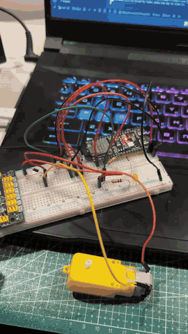
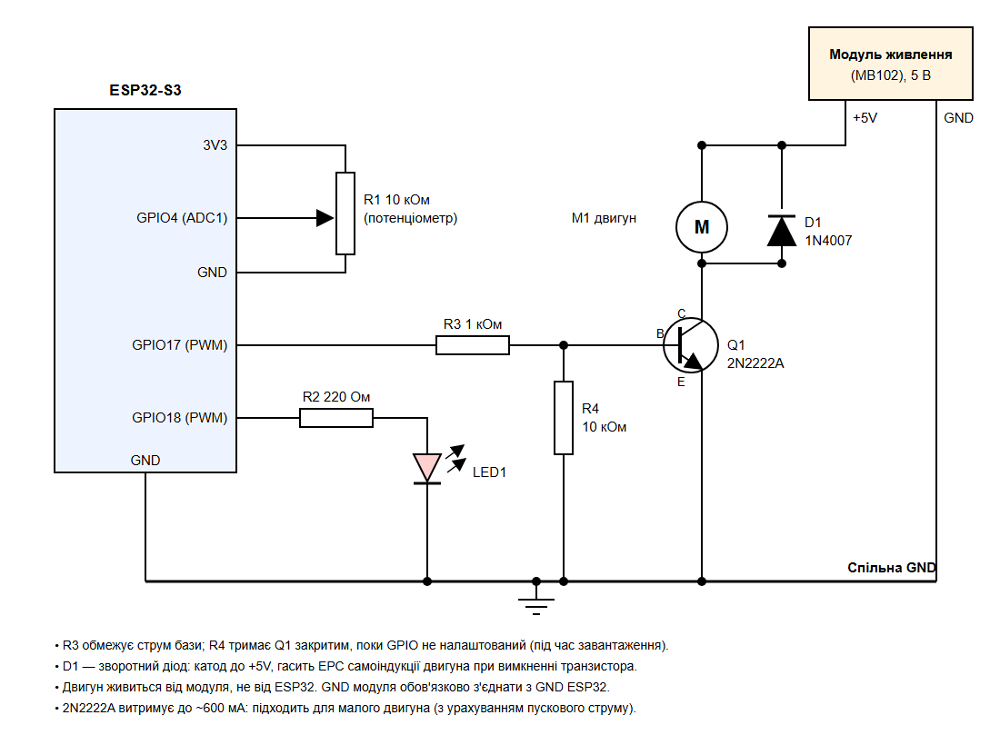

# Домашня робота 3.3: ШІМ (PWM)

Керування яскравістю світлодіода і швидкістю двигуна на ESP32-S3 і ESP-IDF. Потенціометр підключений до ADC1. Його значення перераховується в duty і подається на два незалежні канали LEDC: один керує світлодіодом, другий — двигуном через транзистор 2N2222A.

## Демонстрація



## Завдання

1. Потенціометр керує яскравістю світлодіода.
2. Потенціометр керує швидкістю вала двигуна.
3. Двигун та світлодіод не впливають на роботу одне одного.

## Схема



- **Ключ на транзисторі.** Двигун живиться від окремого модуля живлення 5 В і вмикається транзистором Q1 (2N2222A), бо GPIO не здатен дати потрібний струм.
- **R3 (1 кОм).** Обмежує струм бази: (3.3 − 0.7) / 1000 ≈ 2.6 мА.
- **R4 (10 кОм).** Тримає базу на землі, поки GPIO не налаштований під час завантаження, щоб двигун не смикався.
- **D1 (1N4007).** Зворотний діод паралельно двигуну: гасить ЕРС самоіндукції обмотки, коли транзистор закривається.
- **Спільна земля.** GND модуля живлення з'єднаний з GND ESP32.

## Як це працює

### Два таймери і два канали LEDC

Таймер LEDC задає частоту і роздільну здатність ШІМ, а канал — GPIO і duty. Канали на одному таймері мають спільну частоту, тому кожен вихід має свій таймер:

| Вихід | GPIO | Таймер | Канал | Частота | Роздільна здатність |
| --- | --- | --- | --- | --- | --- |
| Світлодіод | 18 | `LEDC_TIMER_0` | `LEDC_CHANNEL_0` | 1 kHz | 10 біт (0…1023) |
| Двигун | 17 | `LEDC_TIMER_1` | `LEDC_CHANNEL_1` | 10 kHz | 10 біт (0…1023) |

Для двигуна частота вища, щоб обмотка менше пищала. Окремі таймери і канали дають третю вимогу завдання: зміна одного виходу не перезаписує налаштувань іншого.

### Перерахунок АЦП → duty

АЦП повертає 12 біт (0…4095), а ШІМ приймає 10 біт (0…1023). Значення переводиться пропорцією:

```c
int dutyCycle = potValue * DUTY_MAX_VALUE / ADC_MAX_VALUE;
```

Спочатку множення, потім ділення. У цілочисельній арифметиці `potValue / 4095` майже завжди дорівнює 0. Переповнення немає: максимум 4095 × 1023 ≈ 4.2 млн.

### Основний цикл

Кожні 10 мс:

1. `adc_oneshot_read` читає потенціометр (`ADC_CHANNEL_3`, GPIO4, атенюація `ADC_ATTEN_DB_12`).
2. Значення перераховується в duty.
3. `ledc_set_duty` + `ledc_update_duty` оновлюють спочатку канал світлодіода, потім канал двигуна.

## Підключення

| Компонент | GPIO | Примітка |
| --- | --- | --- |
| Середній вивід потенціометра 10 кОм | 4 | ADC1, канал 3; крайні виводи на 3V3 і GND |
| LED | 18 | до GND через резистор 220 Ом |
| База Q1 (двигун) | 17 | через R3 1 кОм, R4 10 кОм на GND |

## Запуск

Плата `adafruit_feather_esp32s3_nopsram`, платформа `espressif32`, фреймворк ESP-IDF.

```sh
pio run
pio run --target upload
```
