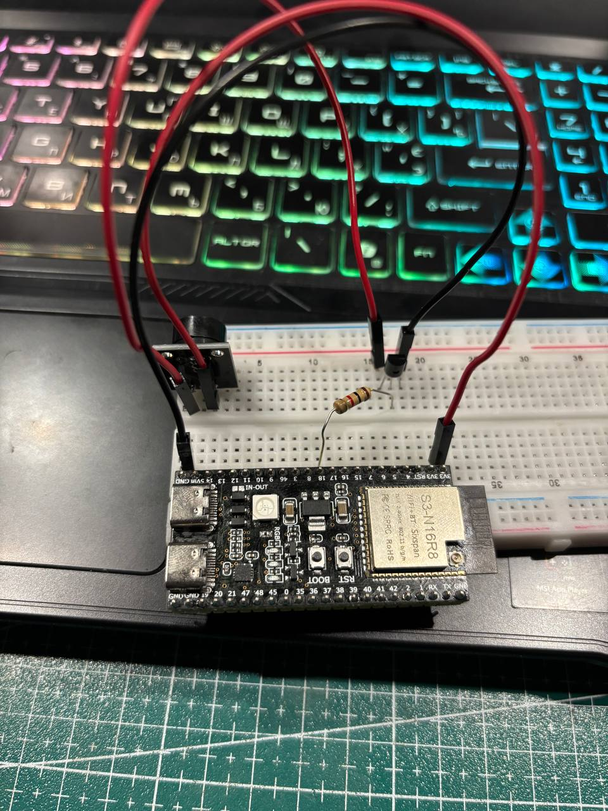

# Домашня робота 3.4: Програвання звуку на зумері (PWM)

Неблокуючий аудіоплеєр для пасивного зумера на ESP32-S3 і ESP-IDF. Висоту ноти задає частота ШІМ (LEDC), темп — періодичний `esp_timer` з тіком 50 мс. Плеєр по колу грає п'ять мелодій із завдання без `vTaskDelay` і без власних задач FreeRTOS.

## Зібрана схема



## Завдання

**Завдання 1.** Неблокуючий аудіоплеєр для зумера, який:

- працює через PWM (LEDC);
- використовує фіксований часовий тік, наприклад 50 мс;
- не блокує виконання програми;
- не використовує FreeRTOS task та delay.

**Завдання 2.** Синтезатор на кілька нот, що грає просту мелодію.

Виконано обидва: плеєр із завдання 1 грає мелодії із завдання 2.

## Як це працює

### Нота = частота ШІМ

Пасивний зумер не має власного генератора: мембрана коливається з частотою сигналу на виході. Тому висоту ноти задає частота таймера LEDC, а duty лише вмикає і вимикає звук:

| Стан | Частота | Duty |
| --- | --- | --- |
| Нота | частота ноти (наприклад, A4 = 440 Гц) | 512 з 1023 (50%) |
| Тиша | без змін | 0 |

На 50% розмах коливань мембрани найбільший, тому звук найгучніший. При 100% на виході постійна напруга, і мембрана не рухається.

- `buzzer_play(freq)` викликає `ledc_set_freq()` і ставить duty 50%.
- `buzzer_silence()` ставить duty 0.

### Мелодія як дані

Мелодії лежать у [src/melodies.c](src/melodies.c) як масиви пар `{частота, тривалість у тіках}`:

```c
static const note_t twinkle_twinkle[] = {
    { NOTE_C4, QUARTER }, { NOTE_C4, QUARTER },
    { NOTE_G4, QUARTER }, { NOTE_G4, QUARTER },
    ...
};
```

Тривалості: `EIGHTH` = 4 тіки (200 мс), `QUARTER` = 8 (400 мс), `HALF` = 16 (800 мс), `WHOLE` = 32 (1.6 с). Пауза — нота `REST` з частотою 0. Щоб додати мелодію, достатньо змінити `melodies.c`, а код плеєра лишається без змін.

| Мелодія | Ноти |
| --- | --- |
| Baby Shark | C D E \| C D E \| C D E |
| Jingle Bells | E E E \| E E E \| E G C D E |
| We Will Rock You | C C D \| C C D \| C C D E |
| Twinkle Twinkle Little Star | C C G G \| A A G |
| Old MacDonald | G G G D E E D |

### Плеєр — машина станів на тіках

`app_main` налаштовує LEDC, запускає періодичний `esp_timer` на 50 мс і завершується. Стан плеєра зберігають три `static` змінні: номер мелодії, номер ноти і кількість тіків, що лишились. На кожен тік `player_tick` робить один крок і одразу повертається:

1. Якщо `ticks_left == 0`, бере наступну ноту, вмикає її і записує її тривалість у `ticks_left`. Коли ноти мелодії скінчились, вмикає тишу на 2 с і переходить до наступної мелодії.
2. На останньому тіку ноти вмикає тишу.
3. Зменшує `ticks_left` на 1.

Четвертна нота триває 8 тіків: 7 тіків звуку і 1 тік тиші. Без цієї паузи дві однакові ноти поспіль (`C C`) злились би в один довгий звук. Через це кожна нота має тривати щонайменше 2 тіки.

Процесор зайнятий лише кілька мікросекунд за тік, решту часу він вільний. `esp_timer` виконує колбеки у своїй системній задачі ESP-IDF: власних задач програма не створює.

На початку кожної мелодії в монітор порту виводиться її назва:

```
I (1234) player: Граю: Jingle Bells
```

## Підключення

| Компонент | GPIO | Примітка |
| --- | --- | --- |
| Пасивний зумер | 18 | через NPN-транзистор BC547B, база підключена до GPIO через резистор Rб = 1 кОм |

Струм зумера більший, ніж може безпечно дати пін ESP32, тому зумер вмикається транзисторним ключем, а GPIO керує лише малим струмом бази.

### Розрахунок резистора бази

Вихідні дані:

| Позначення | Значення | Звідки |
| --- | --- | --- |
| Uпит | 3,3 В | живлення зумера |
| Uсиг | 3,3 В | рівень GPIO ESP32 |
| Rбуз | 45 Ом | опір зумера між S і −, виміряно мультиметром |
| Ube | 0,7 В | база-емітер відкритого транзистора |
| Uke | 0,2 В | колектор-емітер у насиченні |
| hFE мін | 200 | даташит BC547B |
| k | 20 | запас, щоб транзистор був у насиченні |

1. Струм зумера: Iн = (Uпит − Uke) / Rбуз = (3,3 − 0,2) / 45 ≈ **0,069 А** (69 мА).
2. Перевірка транзистора: 69 мА ≤ 100 мА за даташитом ✓
3. Мінімальний струм бази: Iб.мін = Iн / hFE мін = 0,069 / 200 ≈ **0,00034 А** (0,34 мА).
4. Струм бази із запасом: Iб = Iн / k = 0,069 / 20 ≈ **0,0034 А** (3,4 мА).
5. Резистор бази: Rб = (Uсиг − Ube) / Iб = (3,3 − 0,7) / 0,0034 ≈ **755 Ом**. Найближчий менший стандартний номінал (ряд E12) — 680 Ом, але його не було під рукою, тому встановлено найближчий наявний: **1 кОм**.
6. Перевірка піна з 1 кОм: Iб = (3,3 − 0,7) / 1000 = **2,6 мА** ≤ 12 мА для ESP32 ✓

   Фактичний запас k = Iн / Iб = 69 / 2,6 ≈ 26,5, трохи більше за рекомендовані 10…20. Насичення все одно є: навіть з hFE мін транзистор пропустить 200 × 2,6 мА = 520 мА, а це в 7,5 раза більше за 69 мА, потрібні зумеру.
7. Тепло на транзисторі: P = Uke × Iн = 0,2 × 0,069 ≈ **0,014 Вт** (14 мВт) ≪ 500 мВт ✓

## Структура

| Файл | Вміст |
| --- | --- |
| [src/main.c](src/main.c) | LEDC, `esp_timer`, машина станів плеєра |
| [src/melodies.h](src/melodies.h) | частоти нот, тривалості, типи `note_t` і `melody_t` |
| [src/melodies.c](src/melodies.c) | п'ять мелодій і плейлист |

## Запуск

Плата `adafruit_feather_esp32s3_nopsram`, платформа `espressif32`, фреймворк ESP-IDF.

```sh
pio run
pio run --target upload
pio device monitor
```
