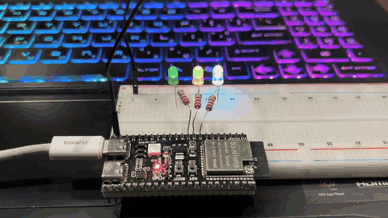

# Домашня робота 6.1: суперцикл на задачах FreeRTOS

Три світлодіоди на ESP32-S3 і ESP-IDF блимають незалежно один від одного з періодами 200, 500 і 1000 мс. Це те саме завдання, що в уроці 2.3, але замість одного суперциклу з перевіркою `millis()` кожен світлодіод керується окремою задачею FreeRTOS, створеною через `xTaskCreate`.

## Демонстрація



## Від суперциклу до задач

Урок 2.3 (Arduino, C++) вирішував завдання так: один `loop()` у нескінченному циклі проходив по масиву світлодіодів і для кожного перевіряв, чи минув його інтервал:

```cpp
for (auto& led : leds) {
    if (now - led.previous >= led.interval) { ... }
}
```

У цій роботі планування часу бере на себе FreeRTOS:

| | Урок 2.3 (суперцикл) | Ця робота (FreeRTOS) |
| --- | --- | --- |
| Хто вирішує, коли перемикати | `loop()` порівнює `now - previous` | планувальник будить задачу після `vTaskDelay` |
| Скільки циклів | один на всі світлодіоди | по одній задачі на світлодіод |
| Що робить процесор між перемиканнями | безперервно опитує час | задачі заблоковані, процесор вільний |
| Поле `previous` | потрібне | не потрібне |

`vTaskDelay` блокує лише ту задачу, яка його викликала, тому інші світлодіоди продовжують блимати за своїм розкладом.

## Як це працює

### Структура `Led` у C

Код переписано з C++ на C. Структура оголошена через `typedef`, щоб тип можна було писати без слова `struct`. Ім'я задачі зберігається в самій структурі:

```c
typedef struct {
    const char* taskName;
    uint8_t pin;
    uint32_t interval;
    bool state;
} Led;
```

Масив `leds` глобальний, тому його елементи існують весь час роботи програми. Це важливо, бо задачі отримують вказівники саме на них.

### Одна функція, три задачі

`blink_task` написана один раз, а `app_main` у циклі створює з неї три задачі:

```c
for (size_t i = 0; i < sizeof(leds) / sizeof(leds[0]); i++) {
    xTaskCreate(blink_task, leds[i].taskName, 2048, &leds[i], 1, NULL);
}
```

| Аргумент | Значення | Пояснення |
| --- | --- | --- |
| функція | `blink_task` | ім'я функції в C автоматично стає вказівником на неї, копія коду не створюється |
| ім'я | `leds[i].taskName` | `"led1"`, `"led2"`, `"led3"`, щоб розрізняти задачі під час дебагу; FreeRTOS копіює рядок до себе (до 16 символів) |
| стек | `2048` | в ESP-IDF розмір задається в байтах, а не в словах, як у звичайному FreeRTOS |
| параметр | `&leds[i]` | адреса свого світлодіода для кожної задачі |
| пріоритет | `1` | однаковий для всіх |
| handle | `NULL` | керувати задачами після створення не потрібно |

`sizeof(leds) / sizeof(leds[0])` дає кількість елементів масиву, тож новий світлодіод достатньо додати в `leds`.

### Передача параметра через `void *`

Сигнатура задачі фіксована: `void (*)(void *)`. Тому `blink_task` приймає `void *`, а всередині першим рядком повертає вказівнику тип:

```c
Led* led = (Led*)parameter;
```

Передається саме адреса (`&leds[i]`), а не структура (`leds[i]`): у `void *` вміщується лише вказівник. До того ж задача змінює `state` у справжньому елементі масиву, а не в копії. Це аналог `auto&` з коду уроку 2.3.

### Тіло задачі

```c
while (1) {
    led->state = !led->state;
    gpio_set_level(led->pin, led->state);
    vTaskDelay(pdMS_TO_TICKS(led->interval));
}
```

`vTaskDelay` приймає тіки, а не мілісекунди, тому інтервал перераховується через `pdMS_TO_TICKS`.

### Налаштування GPIO

Усі три піни налаштовуються одним викликом `gpio_config` з бітовою маскою `(1ULL << pin) | ...` як виходи без підтяжок і переривань. Це заміна `pinMode` з Arduino, а `gpio_set_level` замінює `digitalWrite`.

## Підключення

| Задача | GPIO | Період перемикання |
| --- | --- | --- |
| `led1` | 15 | 200 мс |
| `led2` | 16 | 500 мс |
| `led3` | 17 | 1000 мс |

Кожен LED підключено до GND через струмообмежувальний резистор.

## Запуск

Плата `adafruit_feather_esp32s3_nopsram`, платформа `espressif32`, фреймворк ESP-IDF.

```sh
pio run
pio run --target upload
```
